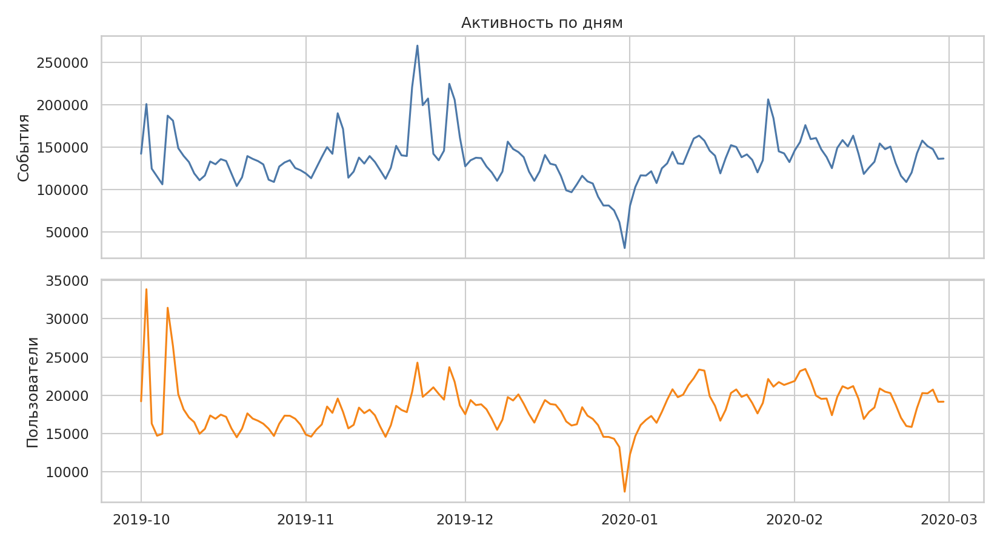
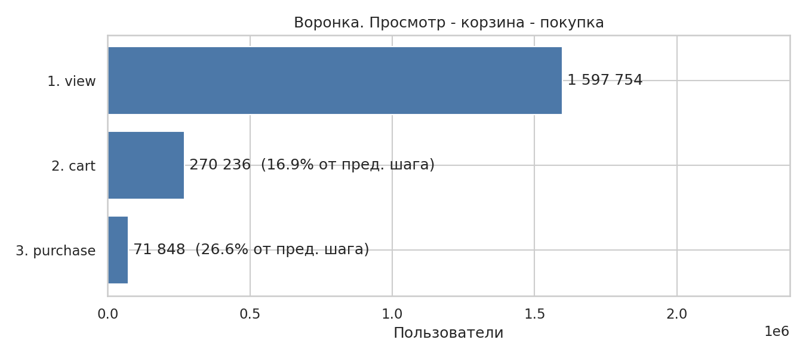
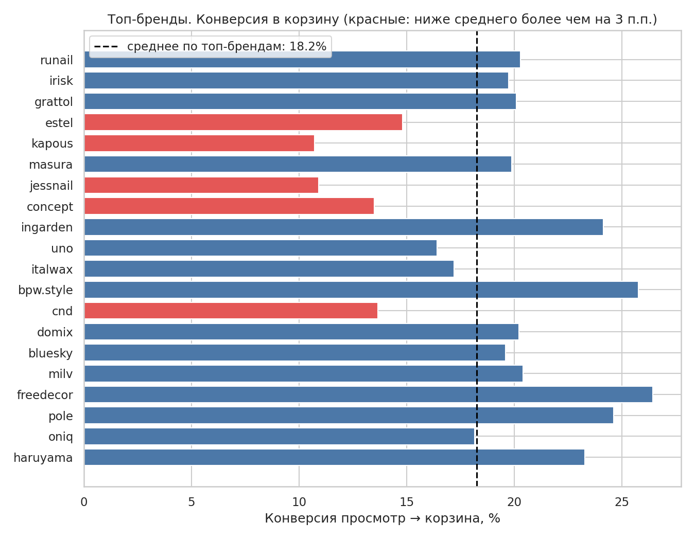
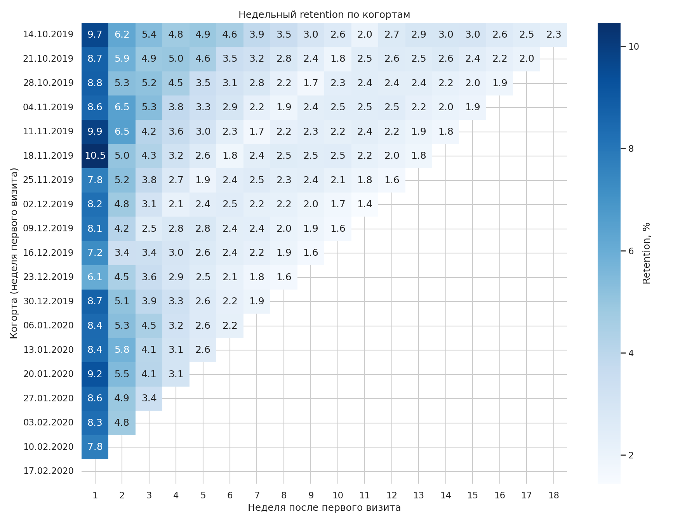
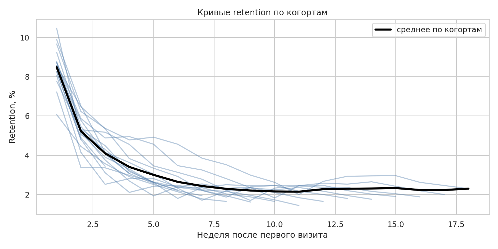

# Анализ воронки и retention онлайн-магазина косметики

[](https://colab.research.google.com/github/albinashu25-byte/funnel-retention-analysis/blob/main/notebooks/analysis.ipynb)

Продуктовая аналитика по логам поведения пользователей интернет-магазина: воронка «просмотр → корзина → покупка», недельный retention по когортам и проект A/B-теста для самого слабого места воронки.

**Стек:** PostgreSQL (CTE, оконные функции, агрегаты с `FILTER`), DBeaver, Python (pandas, matplotlib, seaborn, statsmodels), Google Colab.

---

## Ключевые результаты

| Что искали | Что нашли |
|---|---|
| Где воронка теряет больше всего пользователей | Шаг «просмотр → корзина»: **83,1%** просмотревших не добавляют ничего в корзину. До покупки доходит 4,50% |
| Какие товарные группы отстают | У брендов kapous, jessnail, concept и cnd конверсия в корзину **11,8%** против **20,0%** у остальных топ-брендов (разрыв 8,2 п.п.) |
| Когорта с аномальным retention | Когорта от **16.12.2019**: на 9-й неделе вернулись 1,62% против 2,28% у остальных когорт (≈ −29% относительно, z-тест, p < 0,0001) |
| Что предлагаем | Улучшить карточку товара для брендов с низкой конверсией. A/B-тест: ожидаемый эффект **+1,2 п.п.** (11,8% → 13,0%), выборка ≈ **12 200** пользователей на группу, срок 14 дней |

---

## Данные

- **Источник:** [eCommerce Events History in Cosmetics Shop](https://www.kaggle.com/datasets/mkechinov/ecommerce-events-history-in-cosmetics-shop) (Kaggle, платформа REES46). Условия использования смотрите на странице датасета.
- **Объём:** 20 692 840 событий, [M] пользователей, период: октябрь 2019 – февраль 2020.
- **Структура:** одна строка равна одному событию пользователя.

| Колонка | Описание |
|---|---|
| `event_time` | время события (UTC) |
| `event_type` | `view`, `cart`, `remove_from_cart`, `purchase` |
| `product_id`, `category_id`, `category_code` | товар и категория |
| `brand`, `price` | бренд и цена |
| `user_id`, `user_session` | пользователь и сессия |

**Сами данные в репозиторий не включены** (большой объём), их нужно скачать с Kaggle.

### Очистка и контроль качества

- Строк с пустым `user_id` и неизвестными типами событий нет, все 20 692 840 событий вошли в анализ (представление `events_clean`).
- **Дубликаты** (одинаковые `user_id`, `event_time`, `product_id`, `event_type`): 1 120 960 лишних строк, 5,4%. Они не удалялись: все метрики считаются по уникальным пользователям и на дубликаты не реагируют, а часть повторов у `purchase` может быть реальной покупкой нескольких единиц.
- Пустой `brand` заменён на `unknown`, для цены добавлен флаг `price_valid` (цена > 0).
- У ~95% событий не заполнен `category_code`, поэтому срез по категориям описывает только малую часть аудитории. Основной срез сделан по брендам.



---

## Методология

Тяжёлые проходы по 20 млн строк делались один раз, дальше анализ шёл по небольшим агрегированным таблицам.

1. **Воронка.** Для каждого пользователя найдено время первого просмотра, первого добавления в корзину и первой покупки (`MIN(...) FILTER (WHERE event_type = ...)`). Пользователь учитывается на шаге, только если шаги произошли в правильном порядке.
2. **Срезы воронки.** По категориям и по топ-20 брендам, отфильтрованным по числу просмотров, чтобы проценты были надёжными.
3. **Retention.** Когорта: неделя первой активности пользователя. Retention недели N: доля пользователей когорты, активных через N недель. Учитываются только полные недели, первая полная неделя служит «разогревом» (в неё попадают и те, кто был клиентом до начала данных).
4. **Сравнение когорт.** Оконные функции (`FIRST_VALUE`, `LAG`, `RANK`), сравнение каждой когорты с остальными и z-тест для двух долей.
5. **A/B-тест.** Расчёт базовой конверсии из данных, ожидаемого эффекта, размера выборки (statsmodels) и срока.

---

## Результаты

### 1. Воронка



- Просмотр → корзина: ≈ 16,9% (потеря **83,1%**).
- Корзина → покупка: ≈ 26,6%.
- Общая конверсия просмотр → покупка: **4,50%**.

Главный провал воронки находится на ранней стадии: пользователи смотрят товары, но не откладывают их в корзину.

### 2. Бренды: где конверсия в корзину ниже



Конверсия «просмотр → корзина» сильно различается между брендами (от 10,7% до 26,4%), а конверсия «корзина → покупка» гораздо стабильнее (30–40%). То есть бренды различаются прежде всего решением положить товар в корзину.

| Бренд | Просмотрели | В корзину, % |
|---|---|---|
| kapous | 92 035 | 10,71 |
| jessnail | 78 408 | 10,91 |
| concept | 62 752 | 13,50 |
| cnd | 36 856 | 13,66 |
| *для сравнения:* freedecor | 24 692 | 26,42 |
| *для сравнения:* bpw.style | 42 573 | 25,75 |

Четыре бренда с низкой конверсией в сумме дают 270 тыс. просмотревших, у них самый заметный потенциал роста. Влияние цены и типа товара не исключено и требует отдельной проверки.

### 3. Retention по когортам





- Проанализировано 10 когорт по 58–81 тыс. пользователей, поэтому случайная погрешность retention невелика.
- Retention резко падает после 1-й недели и дальше снижается медленно, это типично для магазинов.
- Когорта **16.12.2019** выделяется: на 9-й неделе 1,62% против 2,28% у остальных (z = −11,25, p < 0,0001).
- **Возможное объяснение:** когорта пришла перед Новым годом, и в ней, вероятно, много разовых «подарочных» покупателей. Данные не позволяют отличить сезонность от различий в качестве трафика, это гипотеза.

---

## Рекомендация и план A/B-теста

**Гипотеза.** Если для товаров брендов kapous, jessnail, concept и cnd улучшить карточку (отзывы и рейтинг, выбор оттенка или объёма на одном экране, заметная кнопка «В корзину», блок «С этим покупают»), то конверсия просмотр → корзина вырастет.

**Метрики**
- Основная: доля пользователей, добавивших в корзину товар целевых брендов, среди просмотревших его.
- Вторичные: конверсия просмотр → покупка по целевым брендам, число добавлений в корзину на пользователя.
- Защитные: доля покупок среди добавивших в корзину, доля `remove_from_cart`, время загрузки карточки.

**Ожидаемый эффект.** База 11,8%, консервативная цель 13,0% (+1,2 п.п., +10% относительно). Это допущение. Оптимистичный сценарий (закрыть треть разрыва с остальными брендами) даёт 14,5%.

**Размер выборки** (α = 0,05, мощность 0,8):

| Относительный прирост | Целевая конверсия | Пользователей на группу |
|---|---|---|
| +5% | 12,41% | 47 849 |
| **+10% (основной сценарий)** | **13,00%** | **12 209** |
| +15% | 13,59% | 5 533 |
| +20% | 14,18% | 3 172 |
| Оптимистичный сценарий | 14,54% | 2 426 |

**Срок.** Трафик целевых брендов ≈ 1 850 новых пользователей в день, для 24 418 пользователей достаточно ≈ 13 дней, поэтому тест длится **14 дней** (две полные недели). За 14 дней на группу приходится ≈ 12 950 пользователей, минимальный обнаружимый эффект h = 0,035 (примерно +1,1 п.п.).

**Дизайн.** Рандомизация по `user_id` 50/50 (стабильный хеш), контроль: текущая карточка. Из теста исключаются боты и аномальные пользователи, пересечений с другими экспериментами нет.

**План анализа.** Проверка разбиения (SRM, хи-квадрат), двухвыборочный z-тест для долей, 95% доверительный интервал разницы, проверка защитных метрик. Тест нельзя останавливать раньше срока и запускать в праздничный период.

> Сам эксперимент не проводился: проект содержит анализ исторических данных и дизайн теста.

---

## Ограничения

- Причина низкой конверсии отдельных брендов не установлена: гипотеза про карточку товара это предположение, которое и должен проверить тест.
- Суммы просмотревших по брендам приблизительные: пользователь, смотревший несколько брендов, учитывается в каждом.
- Из 10 когорт выбрана самая слабая, что завышает значимость различия. Но при z = −11 вывод сохраняется и при поправке на множественные сравнения.
- В данных нет каналов привлечения, акций и стоимости пользователя, поэтому окупаемость и причины сезонных эффектов оценить нельзя.
- Первая когорта включает уже существовавших клиентов, поэтому в анализ retention она не входит.
- Конверсия в покупку у пользователей последних недель может быть занижена: у них было меньше времени докупить.

---

## Структура репозитория

```
funnel-retention-analysis/
├── sql/
│   ├── 01_schema.sql        # создание таблиц, загрузка данных
│   ├── 02_cleaning.sql      # проверки качества, представление events_clean
│   ├── 03_funnel.sql        # воронка и её срезы
│   └── 04_retention.sql     # когорты и недельный retention
├── notebooks/
│   └── analysis.ipynb       # графики, статистические тесты, расчёт A/B-теста
├── results/                 # агрегированные результаты SQL-запросов (CSV)
├── reports/                 # графики
└── README.md
```

## Как воспроизвести

1. Установить PostgreSQL и DBeaver, создать базу `funnel_db`.
2. Скачать данные с [Kaggle](https://www.kaggle.com/datasets/mkechinov/ecommerce-events-history-in-cosmetics-shop) и загрузить CSV в таблицу `events_raw` (схема в `sql/01_schema.sql`).
3. Выполнить скрипты `sql/01_schema.sql` → `04_retention.sql` по порядку.
4. Экспортировать результаты запросов в CSV (готовые файлы лежат в `results/`).
5. Открыть `notebooks/analysis.ipynb` в Google Colab (кнопка вверху), указать путь к CSV и выполнить все ячейки.

## Автор

Альбина · [GitHub](https://github.com/albinashu25-byte)
